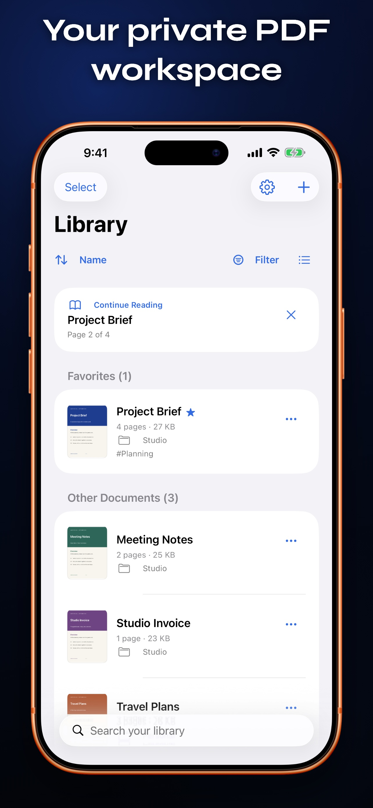

# Folik

Folik is a native, local-first PDF reader and workspace for iPhone and iPad. It is free, open source, and built without accounts, ads, analytics, document uploads, or in-app purchases.

## [Download FolikPDF on the App Store](https://apps.apple.com/app/folikpdf/id6808051666)

**Free for iPhone and iPad. No accounts, ads, or in-app purchases.**

[Visit the Folik website](https://x3n.network/opensource/folik/)

---

<p align="center">
  
</p>

The updated library in **Folik 1.0.2**. Browse in a list or grid, resume reading, merge selected PDFs, and recover removed documents from Recently Deleted.

Current development version: **1.0.4**. See the [1.0.4 release notes](docs/RELEASE_NOTES_1.0.4.md) for the combined usability and performance polish, and [performance measurements](docs/PERFORMANCE_1.0.4.md) for the latest optimization results.

## Current capabilities

- Try an optional local sample form from the empty library or Add tools to practice filling, signing, and sharing

- Import one or more PDFs from Files
- Use **Add to Folik** from the system share sheet in Files, Mail, Safari, and other apps to privately queue up to 20 PDFs for the local library
- Drag PDFs from Files or another app into the Folik library on iPad, with file-backed transfer and visible drop feedback
- Make existing scanned PDFs searchable with on-device OCR, progress, cancellation, and review before saving a new copy
- Create a separate fillable copy of a scan or PDF, use on-device recognition to suggest likely fields, then place, move, resize, and remove standard text, multiline, checkbox, date, and signature fields
- Find literal text, email addresses, phone numbers, and Social Security numbers on-device, review each match, and add selected matches to a redacted copy
- Inspect PDFs for metadata, filled forms, comments, links, outlines, attachments, scripts/actions, and digital-signature fields, then review and save a sanitized image-only copy
- Create a separately named, password-protected PDF and verify that the new copy stays locked until the chosen password is entered
- Compare selectable text between two PDFs on-device, align unchanged pages across insertions or removals, and review added, removed, or changed pages with excerpts
- Run Sanitize PDF from Shortcuts, Siri, Spotlight, or an automation and receive a new local file without changing the original
- Convert JPEG, PNG, or HEIC images from Photos or Files into a named, ordered, searchable multipage PDF (up to 30 images, 20 MB each and 100 MB total)
- Convert Word DOCX and LibreOffice ODT documents on-device, review the generated PDF and conversion notes, then save the exact preview to the library
- Convert TXT (UTF-8/UTF-16) or basic RTF documents up to 5 MB into searchable PDFs with Letter-size pages; complex layouts and attachments are not supported
- Open PDFs in Folik from Files, Mail, Safari, and other apps using the system share sheet or Open In menu
- Scan multi-page paper documents with automatic edge detection and perspective correction, then add an on-device searchable text layer and save them as local PDFs
- Keep a private on-device document library with virtual folders and tags, plus a remembered list or adaptive grid layout
- Optionally lock the app with Face ID, Touch ID, or the device passcode and hide document previews in the app switcher
- Combine 2–20 selected library PDFs, review the merged result, and save a new copy
- Restore one or several PDFs from Recently Deleted with their folders, tags, favorites, bookmarks, and reading position; bulk permanent deletion requires confirmation
- Rename, duplicate, favorite, and sort documents, or select several to organize, share, favorite, or remove together
- Search filenames, folders, tags, and selectable PDF text across the library with a private disposable index, matching-page counts, and highlighted excerpts
- Read PDFs with native PDFKit rendering
- Resume each PDF at its last-viewed page and restore its continuous, single-page, or two-page layout, with a dismissible Continue Reading card
- Browse page thumbnails and switch to Contents within the Pages panel
- Bookmark important pages locally and filter the Pages panel to return to them quickly
- Organize pages in a safe new copy: reorder, rotate, duplicate, delete, extract, insert blanks, or add pages from another PDF—with multi-step undo
- Find text incrementally with result context, progress, and previous/next navigation
- Fill standard AcroForm text, multiline, checkbox, radio, and choice fields, then save values into the local copy
- See required fields, current values, and form progress, then jump directly to the next unfinished field
- Open password-protected PDFs without retaining the password
- Switch between continuous, single-page, and two-page layouts
- Highlight, underline, or strike selected text and save the result
- Draw with a finger or Apple Pencil using selectable colors and widths
- Browse every supported annotation by page, navigate to it, and delete it with undo support
- Place notes, text boxes, rectangles, and circles with multi-step annotation undo and redo
- Add standard Approved, Draft, Confidential, and Final stamps that remain editable in other PDF apps
- Select annotations on the page, drag to move them, resize supported types, or use precise Move and Size controls
- Change annotation colors and adjust drawing or shape line widths with undo and redo
- Create a handwritten or typed signature/initials, keep it locally on-device, and reuse it across PDFs; use Sign directly from Annotations or Forms
- Share a PDF copy with editable annotations and forms, or a flattened copy that makes forms, signatures, and annotations part of the page; sharing waits for your latest changes to save successfully
- Adapt navigation for compact iPhone and regular iPad layouts
- Open different PDFs in dedicated iPad windows for Split View and Stage Manager workflows
- Support Dynamic Type, VoiceOver labels, light mode, and dark mode
- Open Folik settings for the [Folik open-source project website](https://www.x3n.network/opensource/folik/), X3N website, team feedback email, privacy details, version, and Apple Standard EULA

Folik is at the beginning of its development. Keep an original copy of important documents while editing behavior is hardened against a broad compatibility corpus.

### Form compatibility

Choose **Add (+) → Make Fillable Copy**, or begin from a document's **… → Tools** menu, to preserve the source and open an autosaved authoring copy directly in Build. Finish offers a final name after editing; interrupted copies remain in the library. In the reader's **Forms → Build** panel, use **Suggest fields** to scan locally for likely labels, blank boxes, and checkboxes, review every proposed field, and add only the selected results. The persistent Build toolbar adds text, multiline, checkbox, date, or signature fields with repeated page taps or Place center. Arrange lets you edit labels and required flags afterward, duplicate independent blank fields, and undo/redo changes. Resized fields set the size for the next field of that type in the same session. Matching edges snap and show guides during dragging. Switch to Fill to try the form; entered values are saved. Added fields have a visible trash button in the Forms list, with confirmation and undo support. Suggestions are a starting point and may miss fields or infer the wrong type; nothing is uploaded. **Edit layout** supports direct dragging plus visible Move, Size, and Delete controls for accessibility, and its selection outline stays attached while the PDF is panned or zoomed. Field labels are limited to 80 characters, repeated labels receive independent internal field names, and required fields participate in completion tracking.

Folik supports the standard AcroForm widgets that PDFKit can edit on iOS. Checkbox and radio state is saved and restored independently from a field's display string, and radio options with the same field name are counted as one logical field. Required fields are identified from standard field flags and prioritized by the next-field navigator. For documents that expose internal field IDs instead of readable labels, Folik derives a concise label from nearby page text. A date field is a labeled standard text widget rather than a PDF JavaScript calendar, keeping the result broadly compatible and free of embedded scripts. A created signature field is intended for compatible signing apps; Folik can place its own visual handwritten or typed signature from **Annotations → Sign** or **Forms → Sign**, but it does not apply certificate-backed cryptographic signatures. Inspect & Sanitize distinguishes unsigned signature fields from fields containing a PDF signature structure, but Folik does not cryptographically verify signer identity, certificate trust, or document integrity. XFA-only forms cannot be filled by iOS; Folik detects them and explains the limitation instead of showing an empty or misleading editor. JavaScript calculations and other vendor-specific form behavior may vary, so keep an original copy of important forms.

### PDF redaction

Choose **Add (+) → Redact PDF**, then mark rectangles manually or search selectable text for a literal phrase, email addresses, phone numbers, and US Social Security numbers. Pattern matches are suggestions, not guarantees: review and deselect false positives before adding the areas. Scanned pages need **Make PDF Searchable** first. All discovery runs on-device, and nothing is uploaded.

Marked regions are painted into rendered pixels before a fresh image-only PDF is created. Source text, metadata, links, outlines, attachments, and editable form/annotation objects are not copied. Visible annotation appearances are flattened where supported. All output pages lose text selection and interactive features; rendering is limited to 200 dpi and 3,500 pixels on the longest side. Review every page before sharing. The original retains its original information. Protected files are rejected; input/output is limited to 100 MB, 500 pages, and 500 marked regions.

### PDF privacy report and sanitizing

Choose **Add (+) → Inspect & Sanitize** to review information and interactive objects a PDF may carry beyond its visible pages. Folik reports common document metadata, pages with selectable text, filled form values, comments and annotations, links, outlines, attachments or embedded files, catalog-level JavaScript or automatic actions, and digital-signature fields. Inspection happens on-device and does not modify the source PDF.

The sanitized copy rebuilds every page as a new image, including visible annotation and form appearances where PDFKit can display them. Source metadata, selectable or hidden text, links, outlines, attachments, scripts/actions, and editable form or annotation objects are not copied. This also removes text selection, search, links, form editing, accessibility text, and the validity of existing digital signatures. Rendering is limited to 200 dpi and 3,500 pixels per side. Review every page before saving or sharing; the original remains unchanged. Protected files are rejected, and input/output is limited to 100 MB and 500 pages.

The same image-only operation is available as **Sanitize PDF** in Apple Shortcuts. It accepts a PDF file and returns a newly named PDF for the next step in a shortcut or automation. Open **Settings → Shortcuts** in Folik to discover the action.

### Password-protected copies

Choose **Add (+) → Protect PDF** to create a new PDF that requires a password to open. Folik requires 6–128 characters, asks for confirmation, verifies that an empty password cannot open the result, and then verifies the chosen password before offering the copy for saving. The password is cleared from the workflow after processing and is never stored for recovery. Existing protected PDFs must first be exported as an unprotected copy before applying a different password. Keep the unchanged original until the protected copy has been reopened and checked.

### Local PDF comparison

Choose **Add (+) → Compare PDFs**, or begin from a document's **… → Tools** menu, to compare selectable text in two PDFs entirely on-device. Folik aligns identical pages using their normalized extracted text so inserted or removed pages do not automatically make every later page look changed. The report counts aligned, added, removed, and changed pages and provides bounded before/after excerpts.

This is a text-and-page-structure comparison, not a visual or cryptographic comparison. It does not detect changes limited to images, positioning, fonts, colors, annotations, or other appearance details. Scanned PDFs need searchable copies from OCR first. Protected PDFs are rejected. Each input is limited to 100 MB, 500 pages, and 16 MB of extracted text; nothing is uploaded or retained as a comparison history.

### Add to Folik share extension

Choose **Add to Folik** in the system share sheet to send PDFs from Files, Mail, Safari, and other apps into Folik without first navigating through an import picker. The extension checks that every item is a readable PDF, then copies up to 20 files and 100 MB total into Folik's private shared container. The source files remain unchanged.

Queued PDFs move into the local Folik library the next time the app is active. Duplicate names receive a numbered suffix. A file that cannot be moved safely remains in the private queue for a later retry, while valid files continue importing. Sharing and import are entirely on-device and require no Folik account or network connection.

### iPad windows and drag and drop

On iPad, choose **Open in New Window** from a document's actions to place that PDF in a dedicated window. Open different documents side by side with Split View or arrange them with Stage Manager. Requesting the same PDF again brings its existing dedicated window forward instead of creating duplicates. Each window keeps its own reader navigation and panels, and remains connected to its PDF if the document is renamed.

Drop one or more PDFs from Files or another app anywhere over the Folik library to import them. Folik shows a full-library drop target, validates up to 20 readable PDFs and 100 MB total, copies them off the main thread, and removes temporary transfer files afterward. A single imported PDF opens immediately, matching the Files picker. The visible **Choose PDFs from Files** action remains available without dragging, and source files stay unchanged.

### Batch conversion

Choose **Add (+) → Batch to PDF** for up to 20 files and 100 MB total. Add PDFs, supported Office documents, TXT/RTF, or images; move items up/down or remove them before preparing separate PDFs or one combined document. Review each prepared result and its conversion notes, then save the batch. Duplicate filenames get unique suffixes. Preparation failures save nothing; library saving stages and validates every PDF first and rolls back newly moved files on a handled failure. Originals remain unchanged. Combined PDFs can change outlines and page destinations, and retain the conversion limits of each source format.

### Library organization and search

Use a document’s **… → Organize** menu to assign a virtual folder and comma-separated tags. Folder and tag filters narrow the library without moving or renaming files. Organization is stored atomically in an app-local sidecar; unreadable metadata is not silently overwritten. Folder names are limited to 80 characters, with up to 20 tags of 40 characters each.

Library search matches filenames, folder/tag labels, and selectable PDF text, with matching-page counts and up to three highlighted excerpts. Search runs off the main thread, debounces typing, and cancels superseded requests. To make repeat searches fast, extracted text is kept in a bounded, disposable cache protected by iOS file protection; entries are invalidated when a source PDF changes and stale entries are removed. Nothing is uploaded, and the cache is never required to open a document. Locked, unreadable, or oversized documents are skipped with a count. Scanned documents need OCR first.

### PDF compression

Choose **Add (+) → Compress PDF**, then Keep Resolution, Screen Optimized, or Smaller File. Native PDFKit image optimization preserves selectable text and annotations without deliberately flattening them. The preview shows original and result sizes; if optimization would make the file larger, the original bytes are retained and labeled already optimized. Image quality can change, so review before saving a new copy. Protected PDFs are not accepted. Cancellation discards the result after an in-progress native write finishes.

### Existing-PDF OCR

Choose **Add (+) → Make PDF Searchable**. Folik adds an invisible text layer to scanned pages and saves a reviewed new copy. Pages already containing text or annotations are preserved and skipped; the preview reports the counts. OCR can make mistakes, and page destinations/outlines may change. Protected PDFs are not accepted. Input/output limits are 100 MB, 500 pages, and page dimensions up to 40 inches; raster recognition is limited to 3,500 pixels on the longest side. Original page graphics are retained on processed pages.

### Office document conversion

Choose **Add (+) → Documents to PDF** for DOCX, ODT, legacy DOC, and Pages files up to 25 MB. The engine supports styled paragraphs, headings, decimal/alphabetic/Roman lists, embedded raster images (including images in table cells), source margins and table column proportions, horizontal table-cell spans, and searchable text. External web/email links remain clickable. Text boxes enter the reading flow, and footnotes/endnotes are collected at the end. Long paragraphs and table cells continue across PDF pages. Conversion happens entirely on-device, and nothing enters the library until you review the PDF and tap **Save Copy**.

This is a limited document renderer, not a full Word/LibreOffice layout implementation. Fonts may be substituted; image placement, complex table sizing, and pagination may change. Nested tables flow in reading order inside their parent cell. Headers, footers, comments, linked images, charts, and some other objects are unsupported; conversion notes identify detected limitations. Review important documents against their originals. Space-aligned text can have a different extraction/selection order in PDF viewers.

Legacy Word 97–2003 `.doc` files have a **text recovery** mode. It preserves the main text, Unicode, basic paragraph/cell boundaries, page breaks and saved field results. Formatting, images, notes, text boxes and other rich content are omitted, and tracked deletions may appear. The preview explicitly labels this mode. Export DOCX or PDF from Word when fidelity matters.

Pages support is limited to extracting `QuickLook/Preview.pdf` from a ZIP or directory package when present. Those PDF bytes are preserved exactly. Saved previews can be outdated or incomplete; modern Pages files without one require **Export → PDF** in Pages. Thumbnail images are never treated as complete documents.

Google Docs can export a DOCX copy for conversion. Direct Google account access, full Pages layout parsing, and full legacy Word formatting are not included.

See [the conversion engine architecture and compatibility notes](CONVERSION_ENGINE.md).

## Requirements

- iOS or iPadOS 18.6 or later
- Xcode 26.6 or later for development

## Build

Open `Folik.xcodeproj` in Xcode and run the `Folik` scheme, or build an unsigned simulator app:

```sh
DEVELOPER_DIR=/Applications/Xcode.app/Contents/Developer \
  xcodebuild \
  -project Folik.xcodeproj \
  -scheme Folik \
  -configuration Debug \
  -destination 'generic/platform=iOS Simulator' \
  CODE_SIGNING_ALLOWED=NO \
  build
```

## Test

`FolikTests` covers document import, scanned-image PDF generation with extractable OCR text, navigation, per-document bookmark persistence, incremental search, ink annotation persistence, note/text/shape/signature placement, protected reusable-signature storage and migration, annotation movement, resizing, and appearance, multi-step annotation undo and redo, source-preserving page organization, editable and flattened export, authored fillable copies, on-device form-field inference, and a synthetic form corpus containing text, multiline, checkbox, grouped radio, choice, signature, and XFA cases. A checked-in copy of the official [IRS Form W-9 (revision March 2024)](https://www.irs.gov/pub/irs-pdf/fw9.pdf) provides a public real-world regression case for text fields, checkboxes, XFA/AcroForm coexistence, save/reopen, readable field labels, and flattening. Persistence tests reopen written PDFs and verify annotation data, widget values, signature strokes, source preservation, independent field names, and the canonical AcroForm field tree. `FolikUITests` launches with generated document and scanned-page fixtures and exercises the library add menu, reader, page navigation and bookmark filtering, page organizer, annotation workspace, shape and signature placement, accessible annotation and form-field movement and sizing controls, on-device field-suggestion review, form-overlay alignment while zooming, drawing mode, Forms authoring and filling, regular and OCR-backed Find result navigation, About screen, and export choices.

```sh
DEVELOPER_DIR=/Applications/Xcode.app/Contents/Developer \
  xcodebuild test \
  -project Folik.xcodeproj \
  -scheme Folik \
  -destination 'platform=iOS Simulator,name=iPhone 17 Pro' \
  CODE_SIGNING_ALLOWED=NO
```

## Visual identity

The app icon uses Folik's folded-page **F** in standard, dark, and tinted appearances. Source-ready icon variants live in `Folik/Assets.xcassets/AppIcon.appiconset`; the in-app mark is rendered natively in `FolikTheme.swift` so it stays crisp with Dynamic Type and appearance changes.

## Architecture

```text
DocumentLibrary    Imports and owns local PDF copies
SharedPDFInbox     Validates and atomically transfers share-extension PDFs
PDFTransferItem    File-backed iPad drag-and-drop import staging
LibrarySearchIndex Bounded, disposable on-device cache for cross-library text search
PDFPrivacy         On-device document inspection and image-only sanitizing
PDFProtection      Verified password-protected PDF copy generation
PDFComparison      Bounded local text extraction, page alignment, and change reports
FillablePDFView     Source-preserving fillable-copy preparation and authoring entry point
FolikShortcuts     System Sanitize PDF action for Shortcuts, Siri, and Spotlight
DocumentScanner    Native camera capture and scanned-image PDF generation
PDFConverter       Local image and paginated TXT/RTF conversion
PDFConversionView  Image/text selection, image ordering, and conversion review
OfficeDocumentEngine  DOCX/ODT parsing and conversion orchestration
OfficePackage / OfficeXML  Bounded ZIP/XML readers
DOCXReader / ODTReader  Format-specific content and styles
OfficePDFRenderer  Shared searchable text, image and table pagination
OfficeConversionView  Document selection, compatibility notes, PDF preview and save
DocumentSession    Document state, forms, search, navigation, annotations, and persistence
DocumentExporter   Original, editable-copy, and flattened-copy export
PageOrganizer      Source-preserving page operations, merge/extract, and undo
SignatureStore     Protected local storage and legacy migration for reusable signatures
BookmarkStore      Private app-local page bookmarks, isolated by document
PDFKitView         Native PDFView bridge and live ink gesture capture
LibraryView        Library and import experience
LibraryToolsView   Grouped capture, conversion, improvement, and protection tools
ReaderStateStore   Private per-document reading position and layout persistence
ReaderView         Adaptive iPhone/iPad reader chrome
ReaderInspector    Pages, outline, search, and form tools
SettingsView       About, privacy, support, company, and legal links
```

The project intentionally keeps document operations out of SwiftUI views so that OCR, redaction, page editing, and SPDFV-compatible operations can be tested independently.

## Privacy

Folik processes documents locally. See [PRIVACY.md](PRIVACY.md).

## Contributing

See [CONTRIBUTING.md](CONTRIBUTING.md). Small, focused changes with reproducible PDF fixtures are preferred.

## License

Folik is available under the [MIT License](LICENSE).

### Sample form asset

The practice PDF is bundled at `Folik/Resources/SampleForm.pdf` and copied only when requested. Rebuild it with `python3 Tools/create_sample_form.py` in a development environment with ReportLab installed. ReportLab is not an app runtime dependency. Tests verify field independence, saved canonical form values, fresh blank copies, and the sample UI workflow.
