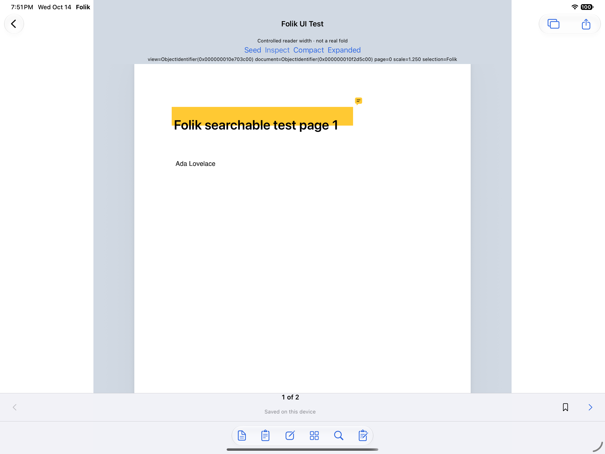
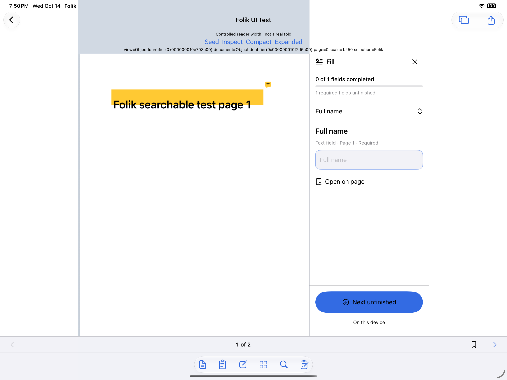
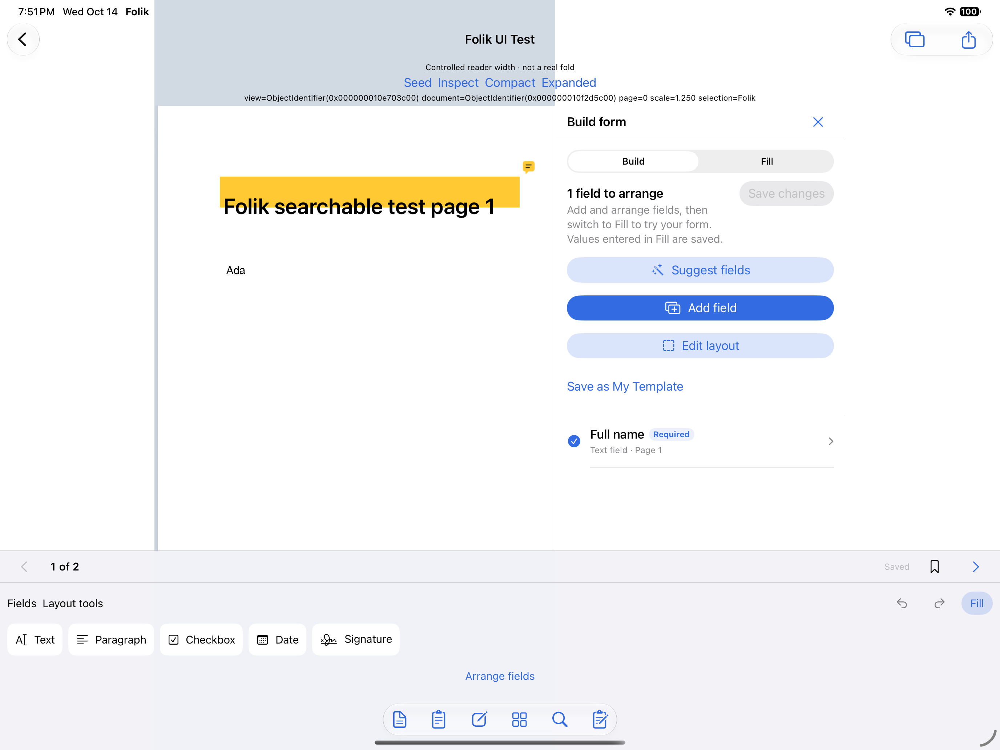

# Shipping reader: controlled expanded-width evidence

These are native XCTest captures of Folik’s integrated production reader, not renders or the standalone design lab. The iPad host gives the reader a controlled 951-point width. The DEBUG-only probe seeds and checks the actual PDFView/document/page/zoom/native selection; the sample answers are isolated test input.

**This is not a real Duo fold.** Standard iPad navigation remains outside the controlled reader width. Screenshots were rotated −90° for upright display, without cropping, resizing, or compositing. The raw images and export manifest remain at `/Users/josephspears/.hermes/cache/scratch/folik-production-wide-final2-attachments/`.

Source test: `AdaptiveReaderUITests/testExpandedFillKeepsPDFContextAndDraftAcrossWidthChanges()` in `folik-production-wide-final2.xcresult`.
Host: `Folik Duo Layout Lab`, iPad Pro simulator, iOS 27.0, `A761FB1E-C160-443C-8437-7977228BB791`.

## Read

## Fill

## Build

